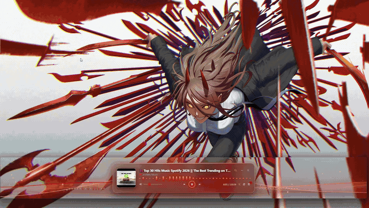

# Immersive Glassmorphism Desktop Music Visualizer 🎵✨

<div align="center">


**A cinematic, audio-reactive desktop music visualizer with speech-reactive time-domain waveforms, real FFT frequency analysis, dynamic wallpaper color blending, and YouTube non-stop streaming.**

<p align="center">
  
</p>

</div>

---

## 🌟 Features

- 🎙️ **Real-Time Audio Analysis (System-Wide Loopback)**:
  - Uses native Windows WASAPI loopback and Linux PulseAudio/PipeWire to capture any sound playing on your system (built-in YouTube player, Spotify, browser, Discord, or games).
  - Multi-band FFT analysis separates sub-bass, vocal fundamentals, vocal rasp/syllables, and treble brilliance.
- 🗣️ **Speech-Reactive Time-Domain Waveform**:
  - The flowing desktop wave is driven directly by live 64-point time-domain oscillations and vocal formants.
  - Fluctuates in real time to speech syllables, spoken words, vocal dynamics, and pauses.
- 🎨 **Dynamic Wallpaper Color Blending**:
  - Automatically samples the active desktop wallpaper and extracts the most aesthetic luminous neon accent palette.
  - Seamlessly blends the widget glass tint, neon borders, glowing play button, equalizer bars, and flowing waves to match your desktop aesthetic.
  - Smoothly cross-fades and morphs colors when you switch wallpapers (*Next Desktop Background*).
- 🪟 **Real-Time Dynamic Glass Dragging**:
  - Drag the player card anywhere across your desktop — the wallpaper background slides in 1:1 lockstep (60 FPS) like physical frosted magnifying glass.
- 🔊 **Two-Way Device Master Volume Sync**:
  - Widget slider matches your exact Windows/Linux system master volume.
  - Hardware keyboard volume keys (Fn + Vol Up/Down) or taskbar changes immediately update the widget slider in real time.
- 🔁 **YouTube Auto-Next & Non-Stop Playback**:
  - Automatically queries and streams related songs from the current artist/genre when a track ends.
  - Automatic error recovery prevents interruptions if a stream expires.

---

## 📥 Installation

### 🪟 Windows (1-Click Automated Installer)

1. Clone or download this repository:
   ```cmd
   git clone https://github.com/villariasa/youtube-desktop-player.git
   cd youtube-desktop-player
   ```
2. Double-click **`install_windows.bat`** (or run `install_windows.ps1` in PowerShell).
3. The installer will:
   - Check Python 3.10+
   - Automatically install all required dependencies from `requirements.txt`
   - Create a **Desktop Shortcut** and a **Start Menu Shortcut** with a custom icon.
   - Generate `launch.bat` for silent background execution.

---

### 🐧 Linux (1-Click Automated Installer & Launcher)

Supports **Ubuntu / Debian / Mint / Pop!_OS**, **Arch Linux / Manjaro**, **Fedora / RHEL**, and **openSUSE**. **No root / sudo password required!**

1. Clone or download this repository:
   ```bash
   git clone https://github.com/villariasa/youtube-desktop-player.git
   cd youtube-desktop-player
   ```
2. Run the 1-click installer:
   ```bash
   chmod +x install_linux.sh
   ./install_linux.sh
   ```
3. The installer will:
   - Configure the standalone application bundle (zero compilation, zero build dependencies).
   - Install the Desktop shortcut (`~/Desktop/Desktop Music Visualizer`) and Application Menu entry.
   - Install the high-res app icon and `youtube-desktop-player` terminal command.
   - Automatically launch the visualizer immediately.

> [!TIP]
> You can also run the player directly from this folder at any time by executing:
> ```bash
> ./launch.sh
> ```
> *(Note for Linux users: Do not use `py widget.py` on Linux—use `./launch.sh` or `python3 widget.py`)*.

---

## 🚀 Running the Visualizer

- **On Windows**: Double-click the **`Desktop Music Visualizer`** icon on your Desktop, or run `launch.bat`.
- **On Linux**: Launch **`Desktop Music Visualizer`** from your Desktop / Application Menu, or run `./launch.sh` in the project folder, or type `youtube-desktop-player` in any terminal.

---

## 🛠️ Controls

| Control | Action |
| :--- | :--- |
| **Play / Pause** | Toggle playback with the glowing circular center button |
| **Search (🔍)** | Search any song or artist on YouTube |
| **Click to Seek** | Click anywhere on the 34 equalizer bars in the player card |
| **Volume Slider** | Adjust volume (synchronized with your system master volume) |
| **Prev / Next** | Skip tracks (Next automatically queries related songs if queue ends) |
| **Shuffle / Repeat** | Toggle shuffle or track looping |
| **Drag & Move** | Click and drag the glass player card to position it anywhere |
| **Minimize / Close** | Minimize to background or exit |
